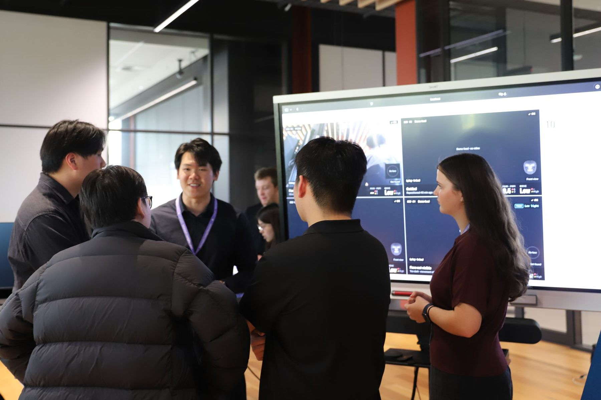
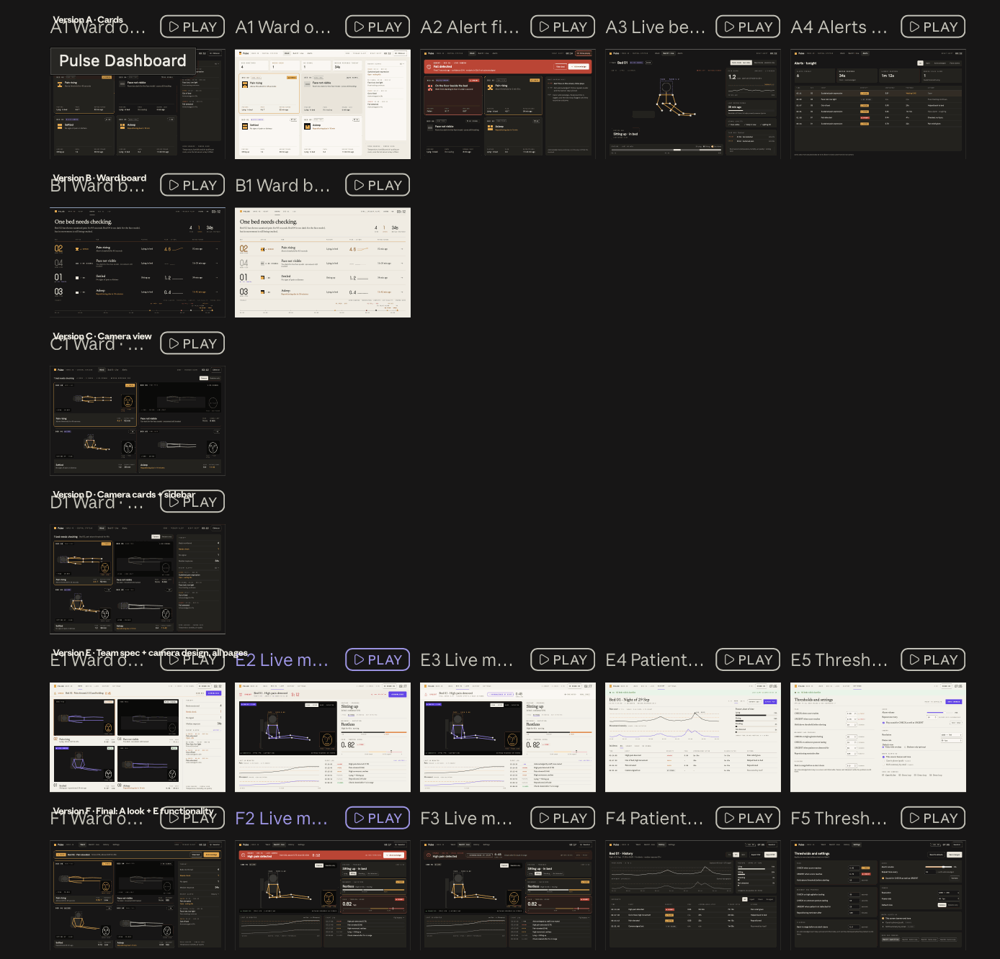

This is the week we presented Pulse at the Monash DeepNeuron showcase, on 7 October 2026. This post covers where the project stands: the carer dashboard, its alerts, the redesign, the pose work, the hardware, and what comes next.

<figure>

<figcaption>Figure 1 · Explaining Pulse to visitors at the Monash DeepNeuron showcase, with the live dashboard running behind us.</figcaption>
</figure>

In week six we decided to move the carer dashboard off Streamlit. Since then we have built what replaces it.

## The dashboard

The carer dashboard is now a web app, with a React frontend talking to a FastAPI backend. It has four pages:

- **Ward** shows every bed at once, so a carer can see which one needs them.
- **Live** shows one bed in detail: the camera view, posture, movement and the pain score.
- **History** shows how a bed's night went, with every alert along the way.
- **Settings** holds the alarm thresholds and the experimental features.

One bed is live, fed by a real camera. The other three are simulated, so the ward view behaves like a ward and we can test what happens when more than one bed needs attention at the same time.

## The alert engine

Each bed has a patient alarm with three levels: **OK**, **CHECK** and **URGENT**. Alongside those are technical alarms, for when the system itself can't be trusted: the camera feed is lost, or the room is too dark to see properly. We keep the two kinds separate on purpose. "The patient may be in pain" and "we can't see the patient" need different responses, and a carer should never have to guess which one they are looking at.

When an alarm fires, a floating alert card appears and stays on screen until someone acknowledges it. It doesn't time out or disappear when the reading drops, because an alert nobody saw is the failure we are most worried about. Acknowledging it pauses the audio, so the room goes quiet once someone is on the way.

The dashboard also records how long each incident took from alert to acknowledgement. That gives us a response time per incident, which matters because it measures the thing that actually helps the patient: how fast a person got there.

## The clinical redesign

The first version looked like a generic web app. It worked, but nothing about it said "this is watching a patient." So we redesigned it, using bedside monitors as the reference instead of websites.

<figure class="figure--framed">

<figcaption>Figure 2 · The redesign board. Six versions of the dashboard, A to F. The bottom row, version F, is the one we built.</figcaption>
</figure>

What changed:

- **Alarm colours and flash rates follow medical alarm conventions.** URGENT is red and flashes faster than CHECK, which is amber. Anyone who has worked near a monitor already knows what those mean, so we don't have to teach them.
- **Big numbers, read like vital signs.** The pain score and other readings are shown large, so they can be read at a glance.
- **A status bar that says "Prototype · not a medical device".** It is always on screen. The dashboard looks more clinical now, and that makes it more important, not less, to be clear about what it is.

## Bringing in the pose work

The dashboard now shows the pose team's work alongside the pain score:

- **Posture**, such as lying down or sitting up in bed.
- **Movement**, using the rewritten movement tracking.
- **Fall detection**, which is still experimental. It sits behind a toggle in Settings, so we can try it without it raising alarms we can't stand behind yet.

## Hardware

The camera cube is being set up to stream video to the laptop running the dashboard, and the LCD pixel faces on the cube are in progress. Both are still being worked on, and we will write them up properly once they run reliably.

## What comes next

The showcase is the end of this stretch, not the end of the project. After it:

- **Calibration with more people**, so the thresholds hold up across a wider range of people.
- **Closing the domain gap.** Our data comes from a lab, not a bedroom at night. [We wrote about that gap](/journal/posts/domain-gap.html) early on, and it is still the biggest open question.
- **Room sensors**, to add information the camera can't give us.
- **A browser-only demo of the dashboard**, so anyone can try it without our camera, our backend or our laptop.

## From the showcase floor

<!-- add photos and reflections after the event -->
