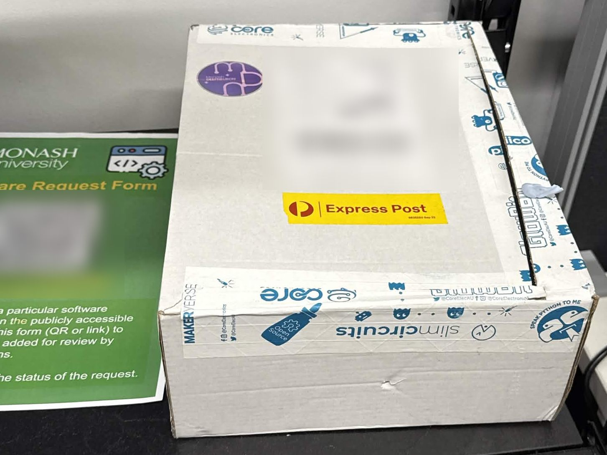

Not everything this week was models.

## The cube

Kate's CAD design for the cube-shaped monitor is nearly done, and the hardware has arrived at Makerspace for assembly. For most of the project the device has been a render and a reference image; it is about to be a thing on a bench. Kate's renders and photos of the parts will go up on [the media page](/media.html).

<figure>
<picture>
<source srcset="/media/makerspace-box.webp" type="image/webp" />

</picture>
<figcaption>FIGURE 1 Our parts box at the Makerspace.</figcaption>
</figure>

## A new teammate

Nageeb joined the team this week and is leading hardware integration. Welcome, Nageeb.

## Everyone else

- **Aaron** is refining body-part weighting in the detection system.
- **Christopher** is researching environmental sensors.

Both ahead of the showcase on 7 October, which is now ten days out.
