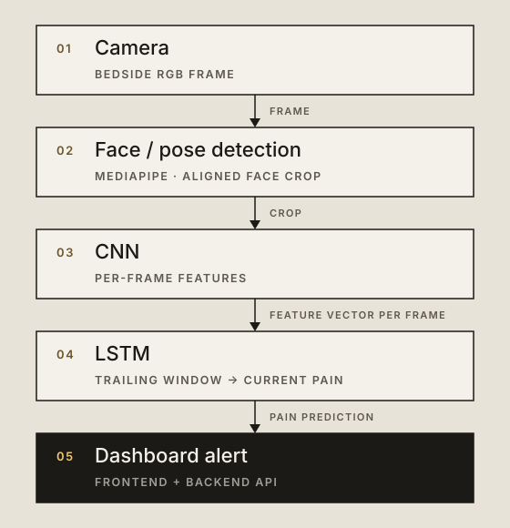
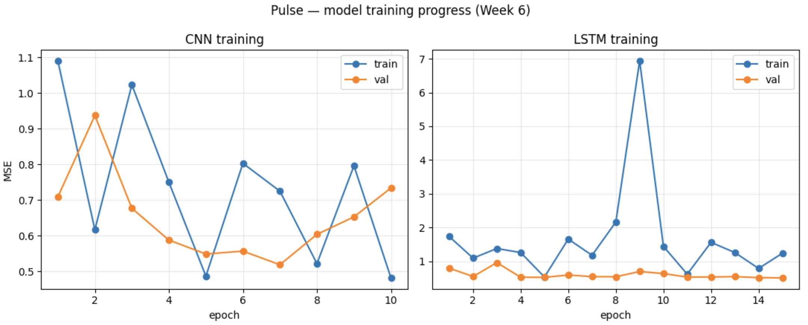

{#- TODO(Nay Chi): CNN FINAL TEST MSE IS UNCONFIRMED. Two runs gave two different values.
    Do not publish until the correct number is confirmed. Search this file for "TODO" before going live. -#}
This week I trained both models myself, end to end. One of them came out worse than the other, and it is the one that was supposed to be better.

<figure class="figure--framed">

<figcaption>Figure 1 · The pipeline as it stands in week 6. This post is about stages 03, 04 and 05.</figcaption>
</figure>

## The CNN had never been trained

When I opened the CNN to wire the LSTM onto it, I found the backbone fully frozen. Nothing in it had ever been fit to our data. Every feature vector it had produced so far came from weights that knew nothing about pain.

So I trained it, with three changes:

- **Unfroze layer4 and the head.** The earlier layers stay frozen; the last block and the head now actually learn.
- **Inverse-frequency weighted loss.** About 94% of our frames are pain-free. [As the dataset post showed](/journal/posts/shape-of-pain.html), that imbalance is structural, not a preprocessing problem, so the fix has to live in the loss: without weighting, predicting "no pain" on every frame is almost free.
- **Matched preprocessing to the live pipeline.** Training was using a plain resize. The live pipeline feeds the CNN an aligned face crop. A model trained on one and served the other is being tested on a distribution it never saw, which is exactly the kind of mismatch [the contract](/journal/posts/contract.html) was written to catch. Training now uses the same aligned-crop approach.

Over 10 epochs, validation MSE settled between 0.5 and 0.6, with the best checkpoint at epoch 7 (0.519). Training MSE stayed noisier the whole way through. That is expected: the weighted loss makes each rare pain frame count for much more, so how many of them land in a given batch swings the batch loss a lot.

The CNN's test MSE is still being confirmed.

## The LSTM, and the gap

The LSTM takes the CNN's per-frame features, windows them, and predicts current pain from the trailing window. It is the whole reason our architecture has two stages: pain [builds and holds](/journal/posts/shape-of-pain.html), so a model that sees the last stretch of frames should do at least as well as one that sees a single frame.

Right now it doesn't. On the test set, the LSTM trails the CNN's frame-level number.

<figure class="figure--framed">

<figcaption>Figure 2 · CNN and LSTM train and validation MSE per epoch. CNN best val MSE 0.519 (epoch 7); LSTM best val MSE 0.502 (epoch 15). The LSTM's test performance currently trails the CNN's, and we are still investigating why.</figcaption>
</figure>

On validation the two are close, and the LSTM is slightly ahead: 0.502 against the CNN's 0.519. On test the order flips. A chart with only train and validation curves would hide the most important thing about this model right now, so I'm saying it here.

I haven't explained the gap yet. My leading suspicion is the split rather than the model. With 25 subjects, [which people end up in the test set moves the number a lot](/journal/posts/shape-of-pain.html), and a small test split can make a reasonable model look bad (or a bad one look reasonable). But that is a hypothesis, not a finding, and I'm still working through it. Until I can say which it is, the honest summary is: the LSTM currently underperforms the CNN, and pinning down why is what I'm working on now.

## Off Streamlit

We are moving the dashboard off Streamlit. It can't handle the latency and alert timing a hospital setting needs: an alert that arrives late or on an unpredictable schedule is worse than no alert, because a carer learns not to trust it. The dashboard is being rebuilt as a proper frontend talking to a backend API, which is stage 05 in Figure 1.

## Everyone else

- **Kate's** CAD design for the cube-shaped monitor is nearly done, and the hardware has arrived at Makerspace for assembly.
- **Naguib** joined the team this week and is leading hardware integration. Welcome, Naguib.
- **Aaron** is refining body-part weighting in the detection system.
- **Christopher** is researching environmental sensors.

All of it is aimed at the showcase on 7 October.

## Close unresolved

The showcase is ten days out and the model that is supposed to carry our temporal argument is currently losing to the one it sits on top of. Next week is finding out whether that is the split or the LSTM, before we put either number in front of anyone.
